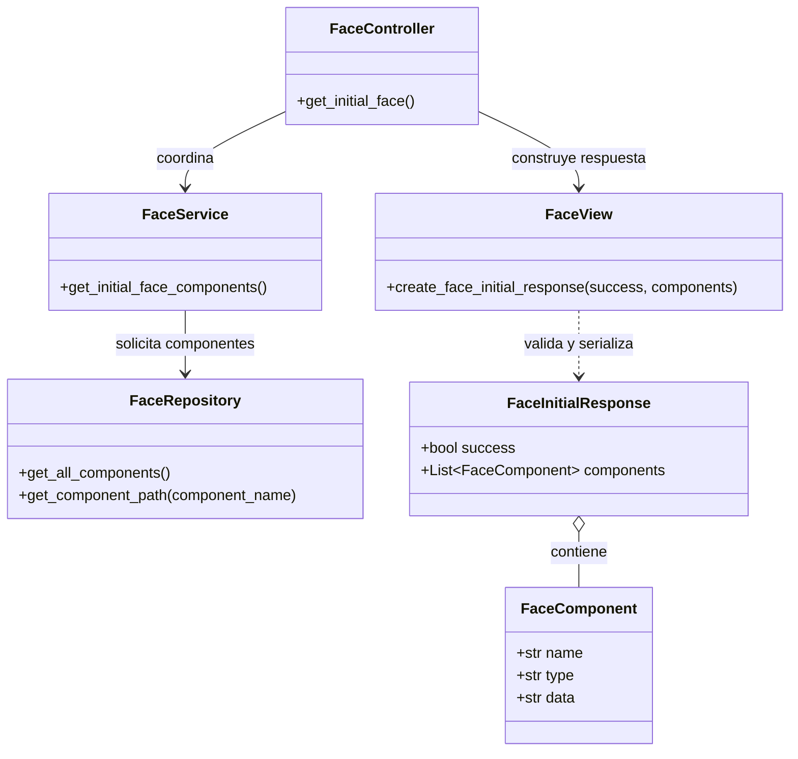
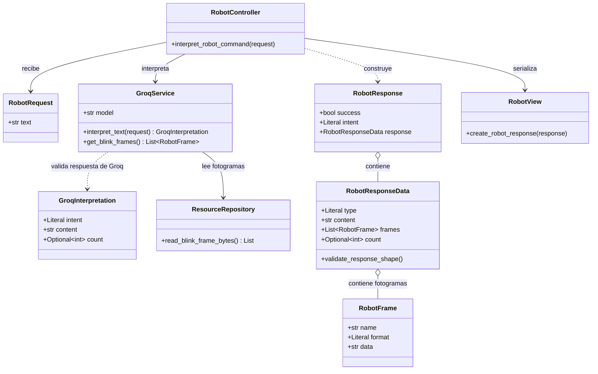

# Diagrama de clases y componentes

Las rutas están implementadas como funciones de módulo de FastAPI, no como clases controlador. En el diagrama se representan los módulos de controlador para mostrar sus colaboraciones.

## Descripción de las clases

### Endpoint `GET /api/v1/face/initial`

- **FaceController:** recibe la solicitud y traduce errores de lectura a estados HTTP.
- **FaceService:** coordina la obtención de los componentes faciales.
- **FaceRepository:** mantiene el catálogo de componentes, lee los PNG y los codifica en Base64.
- **FaceComponent / FaceInitialResponse:** validan la forma de los datos de salida.
- **FaceView:** serializa el modelo de respuesta a JSON.

### Endpoint `POST /api/v1/robot/interpret`

- **RobotRequest:** valida el campo de texto recibido.
- **GroqService:** envía las instrucciones y el mensaje a Groq, valida la intención y codifica fotogramas cuando se solicitan.
- **GroqInterpretation:** admite las intenciones `blink` y `text`, contenido no vacío y una cantidad opcional limitada a 1–10.
- **ResourceRepository:** lee los bytes de `1.png`, `2.png` y `3.png` en ese orden.
- **RobotFrame:** valida cada nombre, formato PNG y contenido Base64 no vacío.
- **RobotResponseData / RobotResponse:** validan los campos de respuesta y que la intención corresponda al tipo (`blink`/`animation`, `text`/`text`).
- **RobotView:** devuelve el modelo validado como JSON.
