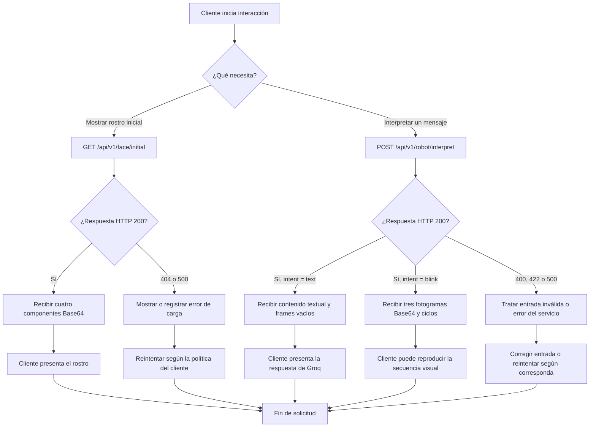

# Flujo de usuario para los dos endpoints

## Flujo general

## Solicitud de rostro inicial

1. El cliente solicita `GET /api/v1/face/initial` al iniciar o reconstruir la vista del robot.
2. Durante la petición puede mostrar un estado de carga.
3. En HTTP 200, obtiene los componentes `boca`, `nariz`, `ojo-derecho` y `ojo-izquierdo`.
4. El cliente decodifica cada valor Base64 para presentar el rostro.
5. Ante HTTP 404 o 500, el cliente comunica el fallo y decide si ofrecer un reintento.

Este endpoint no llama a Groq ni carga los fotogramas de parpadeo.

## Interpretación de texto y solicitud de parpadeo

1. El cliente envía `POST /api/v1/robot/interpret` con `{"text": "..."}`.
2. El backend consulta a Groq; el cliente espera una respuesta HTTP.
3. Para una conversación, recibe `intent: "text"`, el contenido generado y `frames: []`.
4. Para una orden afirmativa de parpadeo, recibe `intent: "blink"`, `type: "animation"`, los tres fotogramas ordenados y `count`.
5. El cliente puede utilizar los datos para presentar una animación. La reproducción ocurre del lado consumidor y no forma parte del backend.
6. Ante errores HTTP, el cliente debe distinguir entrada inválida de indisponibilidad del servicio.

## Responsabilidades del cliente

- Enviar JSON y manejar los códigos HTTP.
- Decodificar o presentar los datos de imagen recibidos.
- No interpretar el texto por su cuenta para decidir el parpadeo: debe usar `intent` del backend.
- No esperar que el backend controle hardware o realice movimientos físicos.
