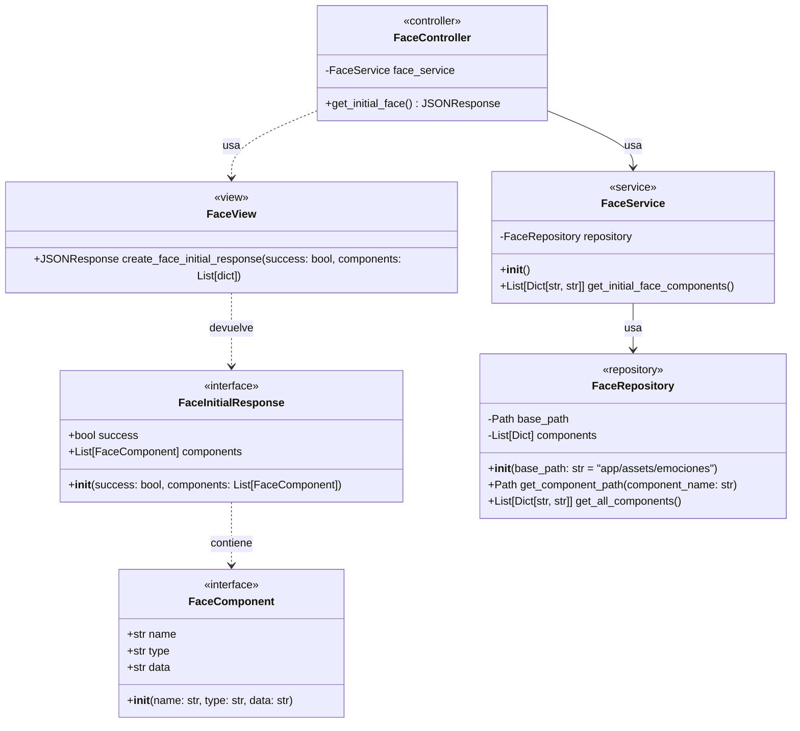

# Diagrama de Clases - Backend WORSHIP Mascot Robot


```

## Descripción del Diagrama de Clases

### Modelo (Models)
- **FaceComponent:** Representa un componente facial individual con su nombre, tipo MIME y datos en Base64
- **FaceInitialResponse:** Representa la respuesta completa del endpoint, indicando éxito y lista de componentes

### Repositorio (Repositories)
- **FaceRepository:** Responsable de acceder al sistema de archivos para obtener los componentes faciales
  - `base_path`: Ruta al directorio donde se almacenan los componentes
  - `components`: Lista estática que define los componentes disponibles y sus ubicaciones
  - `get_component_path()`: Obtiene la ruta completa a un archivo de componente específico
  - `get_all_components()`: Lee todos los componentes, los codifica en Base64 y los retorna

### Servicio (Services)
- **FaceService:** Contiene la lógica de negocio para obtener los componentes faciales
  - `repository`: Instancia de FaceRepository utilizada para acceder a los datos
  - `get_initial_face_components()`: Obtiene todos los componentes faciales a través del repositorio

### Controlador (Controllers)
- **FaceController:** Maneja las solicitudes HTTP relacionadas con los componentes faciales
  - `face_service`: Instancia de FaceService utilizada para obtener los datos de negocio
  - `get_initial_face()`: Endpoint que maneja GET /api/v1/face/initial, coordina service y view, maneja excepciones

### Vista (Views)
- **FaceView:** Responsable de formatear la respuesta HTTP
  - `create_face_initial_response()`: Crea una respuesta JSONResponse con los datos formateados según el modelo

### Flujo de Dependencias
El controlador depende del servicio, el servicio depende del repositorio, y el controlador también utiliza la vista para formatear la respuesta. Las clases de modelo son utilizadas por múltiples capas para definir la estructura de los datos.