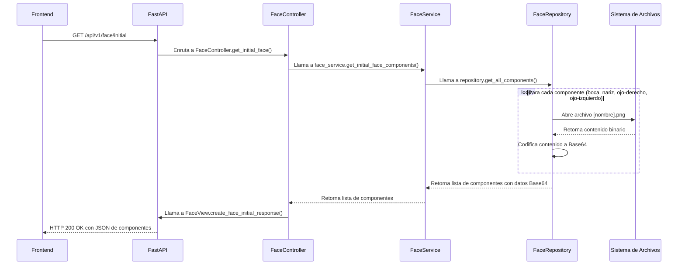
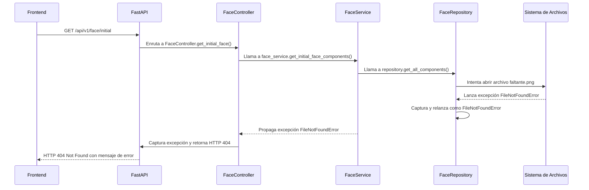
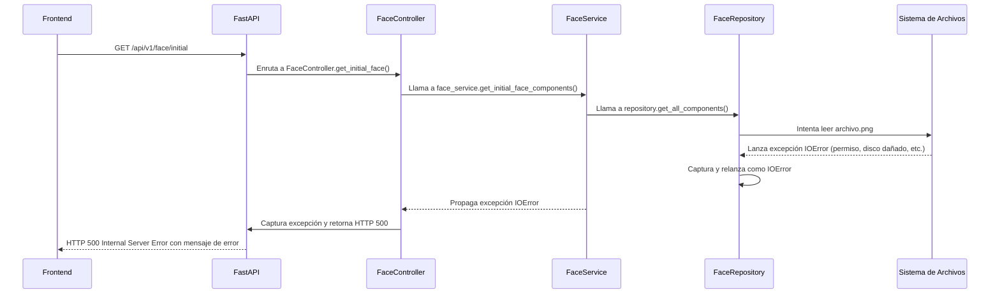
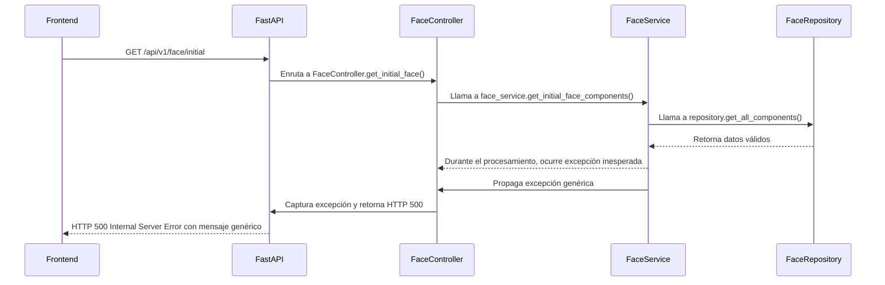

# Flujo del Endpoint - Backend WORSHIP Mascot Robot

## Descripción
Este documento muestra el flujo detallado de cómo una solicitud HTTP atraviesa todas las capas del backend hasta generar la respuesta JSON, así como el flujo de manejo de errores.

## Flujo de Éxito (Secuencia Normal)

## Flujo de Error - Archivo Faltante

## Flujo de Error - Error de Lectura

## Flujo de Error - Error Inesperado

## Detalles de Cada Capa en el Flujo de Éxito

### 1. FastAPI → FaceController
- FastAPI recibe la solicitud HTTP
- La enruta al método apropiado basado en el path y método HTTP
- Inyecta automáticamente cualquier dependencia declarada

### 2. FaceController → FaceService
- El controlador valida que el servicio esté disponible
- Llama al método de servicio para obtener los datos de negocio
- Maneja cualquier excepción que pueda lanzar el servicio

### 3. FaceService → FaceRepository
- El servicio coordina la obtención de datos
- Delegar la responsabilidad de acceso a datos al repositorio
- No contiene lógica de acceso directo a archivos

### 4. FaceRepository → Sistema de Archivos
- El repositorio implementa el acceso real a los datos
- Lee los archivos físicos desde el disco
- Codifica los datos binarios a Base64 para transporte seguro en JSON
- Maneja errores específicos de acceso a archivos

### 5. FaceRepository → FaceService
- Retorna los datos procesados en el formato esperado
- Los errores se propagan como excepciones para ser manejados por capas superiores

### 6. FaceService → FaceController
- Retorna los datos de negocio al controlador
- Mantiene la separación entre lógica de negocio y manejo HTTP

### 7. FaceController → FaceView → FastAPI
- El controlador delega la formateo de la respuesta a la vista
- La vista crea el objeto de respuesta apropiado
- FastAPI serializa la respuesta y la envía al cliente