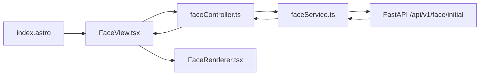

# 01 — Arquitectura Frontend

## 1. Descripción general
Frontend Astro + React que muestra el rostro de la mascota WORSHIP consumiendo el endpoint facial del backend FastAPI.

## 2. Alcance funcional
Únicamente carga y renderiza los 4 componentes faciales (boca, nariz, ojo-derecho, ojo-izquierdo) en Base64. Sin chat, animaciones, Groq, MQTT ni control físico.

## 3. Tecnologías
- Astro: páginas y montaje.
- React: vista, estado y renderizado.
- TypeScript: contratos.
- Fetch API: HTTP.
- CSS inline mínimo: posicionamiento.

## 4. Arquitectura MVC
Models → Services → Controllers → Views → Components. Astro page como punto de entrada.

## 5. Estructura real
```
src/
├── pages/index.astro
├── models/faceModel.ts
├── services/faceService.ts
├── controllers/faceController.ts
├── views/FaceView.tsx
└── components/FaceRenderer.tsx
```

## 6. Responsabilidades
- models/faceModel.ts: interfaces FaceComponent, FaceResponse.
- services/faceService.ts: GET, valida response.ok, JSON, success, 4 componentes con name/type/data. URL base desde `import.meta.env.PUBLIC_API_BASE_URL`.
- controllers/faceController.ts: `loadFace()` coordina llamada.
- views/FaceView.tsx: carga inicial, loading, error+retry, renderiza FaceRenderer.
- components/FaceRenderer.tsx: construye `data:${type};base64,${data}` por name.
- pages/index.astro: monta `<FaceView client:load />`.

## 7. Dependencias
index.astro → FaceView → faceController → faceService → backend.

## 8. Integración React en Astro
`@astrojs/react`, directiva `client:load`.

## 9. URL base
`PUBLIC_API_BASE_URL` en `.env` (http://127.0.0.1:8000). Centralizada en faceService.

## 10. HTTP/JSON
GET `/api/v1/face/initial`, respuesta JSON.

## 11. Base64 → imagen
`const src = \`data:${component.type};base64,${component.data}\`;`

## 12. Manejo de errores
Conexión, HTTP no ok, JSON inválido, success false, componentes faltantes, data vacía. Vista muestra mensaje y retry.

## 13. Límites frontend/backend
Frontend no implementa IA, no controla robot. Backend provee datos.

## 14. Diagrama

