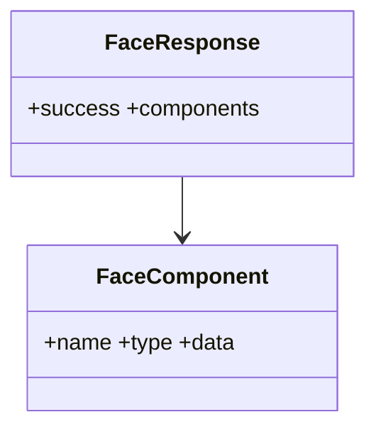

# 02 — Diagrama de Clases

## Modelos
- `FaceComponent`: name:string, type:string, data:string.
- `FaceResponse`: success:boolean, components:FaceComponent[].

## Funciones
- `fetchFaceInitial(): Promise<FaceResponse>` (service).
- `loadFace(): Promise<FaceResponse>` (controller).

## Vista
`FaceView`: estados loading, error, data; efecto inicial; retry.

## Componente
`FaceRenderer(props:{components})`: busca por name y renderiza img.

## Relaciones
index.astro → FaceView → loadFace → fetchFaceInitial → backend.

