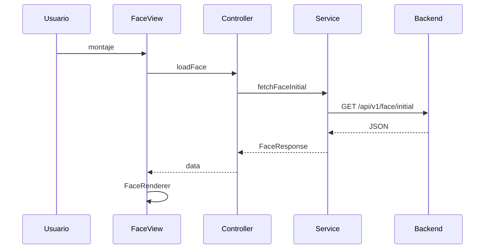

# 04 — Flujo Endpoint

Método: GET. Ruta: `/api/v1/face/initial`. Base: `PUBLIC_API_BASE_URL`.

URL final: `http://127.0.0.1:8000/api/v1/face/initial`.

Service ejecuta fetch, comprueba `response.ok`, parsea JSON, valida `success`, array de 4, cada componente name/type/data. Entrega a controller, actualiza estado React, FaceRenderer construye `data:${type};base64,${data}`.

Errores: conexión, HTTP, JSON, success, componentes.

Ejemplo respuesta como contrato (Base64 ilustrativo).

