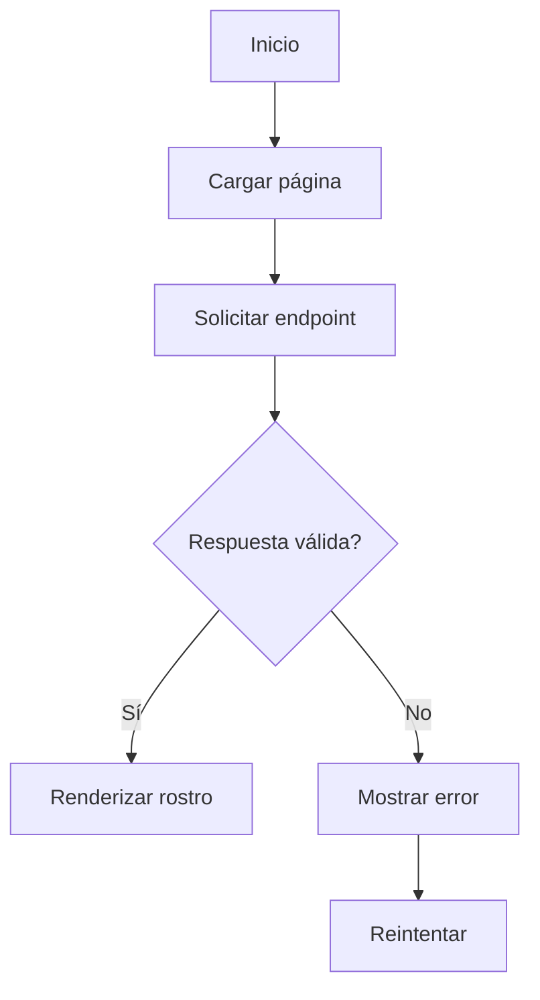

# 05 — Flujo Usuario

Estados: loading, success, error.

Inicio → cargar página → montar React → solicitar endpoint → ¿válido? Sí → renderizar rostro → fin. No → error → retry (si implementado).

Backend desconectado → error + retry.

